# qoodish-api

The Qoodish API: a Cloudflare Worker written with Hono that keeps its records in D1 through Drizzle ORM. The JSON shapes of its responses are declared in `packages/api-contract` and shared with `apps/web` and `apps/admin`. The rules for changing it are in `CLAUDE.md`.

## Develop

```bash
pnpm db:migrate:local   # apply migrations to the local D1 that cf dev uses
pnpm dev                # run the dev worker locally
pnpm test
pnpm typecheck
```

Routes outside `/guest/*`, `/admin/*` and the health checks need a Firebase ID token of the dev project in `Authorization: Bearer <token>`. `/admin/*` needs a Cloudflare Access assertion in `Cf-Access-Jwt-Assertion` instead. `GET /me/journeys/:id` also needs the `ENCRYPTION_PRIMARY_KEY` and `ENCRYPTION_KEY_DERIVATION_SALT` secrets to decrypt the journey's path. Delivering the Web Push of a new notification needs `GOOGLE_PRIVATE_KEY`, the private key of the dev service account named by `GOOGLE_CLIENT_EMAIL`. `POST /images` needs the `CLOUDFLARE_IMAGES_API_TOKEN` secret, an API token with Cloudflare Images edit permission, to request a direct upload URL.

## Data model

The diagram below is generated from `src/db/schema.ts`. After changing the schema, run `pnpm db:erd` to update it; `pnpm test` fails while it is out of date.

```mermaid
erDiagram
  users ||..o{ blocks : "blocked_id"
  users ||..o{ blocks : "blocker_id"
  maps ||..o{ bookmarks : "map_id"
  users ||..o{ bookmarks : "user_id"
  chapter_revisions ||..o{ chapter_revision_images : "chapter_revision_id"
  images ||..o{ chapter_revision_images : "image_id"
  chapters ||..o{ chapter_revisions : "chapter_id"
  users ||..o{ chapter_revisions : "user_id"
  chapter_revisions |o..o{ chapters : "current_revision_id"
  journeys |o..o| chapters : "journey_id"
  maps |o..o{ chapters : "map_id"
  users ||..o{ chapters : "user_id"
  maps ||..o{ coauthorship_invitations : "map_id"
  users ||..o{ coauthorship_invitations : "invitee_id"
  users ||..o{ coauthorship_invitations : "inviter_id"
  maps ||..o{ coauthorships : "map_id"
  users ||..o{ coauthorships : "user_id"
  comments ||..o{ comment_revisions : "comment_id"
  users ||..o{ comment_revisions : "user_id"
  comment_revisions |o..o{ comments : "current_revision_id"
  maps ||..o{ featured_maps : "map_id"
  users ||..o{ images : "user_id"
  journals ||..o{ journal_bookmarks : "journal_id"
  users ||..o{ journal_bookmarks : "user_id"
  journals ||..o{ journal_revisions : "journal_id"
  users ||..o{ journal_revisions : "user_id"
  journal_revisions |o..o{ journals : "current_revision_id"
  users ||..o| journals : "user_id"
  images ||..o{ journey_checkin_images : "image_id"
  journey_checkins ||..o{ journey_checkin_images : "journey_checkin_id"
  journey_checkins ||..o{ journey_checkin_revisions : "journey_checkin_id"
  pins |o..o{ journey_checkin_revisions : "pin_id"
  users ||..o{ journey_checkin_revisions : "user_id"
  journey_checkin_revisions |o..o{ journey_checkins : "current_revision_id"
  journeys ||..o{ journey_checkins : "journey_id"
  pins |o..o{ journey_checkins : "pin_id"
  maps |o..o{ journeys : "map_id"
  users ||..o{ journeys : "user_id"
  images ||..o{ map_revision_images : "image_id"
  map_revisions ||..o{ map_revision_images : "map_revision_id"
  maps ||..o{ map_revisions : "map_id"
  users |o..o{ map_revisions : "user_id"
  map_revisions |o..o{ maps : "current_revision_id"
  users ||..o{ maps : "user_id"
  journeys ||..o{ milestones : "journey_id"
  pins |o..o{ milestones : "pin_id"
  staff_members |o..o{ moderation_decisions : "staff_member_id"
  users |o..o{ moderation_decisions : "author_id"
  users |o..o{ moderation_decisions : "moderator_id"
  users ||..o{ mutes : "muted_id"
  users ||..o{ mutes : "muter_id"
  maps ||..o{ pin_properties : "map_id"
  pin_property_revisions |o..o{ pin_properties : "current_revision_id"
  pin_property_options ||..o{ pin_property_option_revisions : "pin_property_option_id"
  users |o..o{ pin_property_option_revisions : "user_id"
  pin_properties ||..o{ pin_property_options : "pin_property_id"
  pin_property_option_revisions |o..o{ pin_property_options : "current_revision_id"
  pin_properties ||..o{ pin_property_revisions : "pin_property_id"
  users |o..o{ pin_property_revisions : "user_id"
  images ||..o{ pin_revision_images : "image_id"
  pin_revisions ||..o{ pin_revision_images : "pin_revision_id"
  pin_property_options ||..o{ pin_revision_property_options : "pin_property_option_id"
  pin_revisions ||..o{ pin_revision_property_options : "pin_revision_id"
  pins ||..o{ pin_revisions : "pin_id"
  users ||..o{ pin_revisions : "user_id"
  maps ||..o{ pins : "map_id"
  pin_revisions |o..o{ pins : "current_revision_id"
  users ||..o{ pins : "user_id"
  users |o..o{ reports : "reporter_id"
  roles ||..o{ role_permissions : "role_id"
  roles ||..o{ staff_member_roles : "role_id"
  staff_members ||..o{ staff_member_roles : "staff_member_id"
  users ||..o{ user_preferences : "user_id"
  users ||..o{ user_revisions : "user_id"
  images |o..o{ users : "image_id"
  user_revisions |o..o{ users : "current_revision_id"
  blocks {
    integer id PK
    integer blocked_id FK
    integer blocker_id FK
    text created_at
  }
  bookmarks {
    integer id PK
    text created_at
    integer map_id FK
    text updated_at
    integer user_id FK
  }
  chapter_revision_images {
    integer id PK
    integer chapter_revision_id FK
    text created_at
    integer image_id FK
    text updated_at
  }
  chapter_revisions {
    integer id PK
    integer chapter_id FK
    text content
    text created_at
    text map_features
    text status
    text title
    text updated_at
    integer user_id FK
  }
  chapters {
    integer id PK
    text content
    text created_at
    integer current_revision_id FK
    integer journey_id FK, UK
    text map_features
    integer map_id FK
    text status
    text title
    text updated_at
    integer user_id FK
  }
  coauthorship_invitations {
    integer id PK
    text created_at
    integer invitee_id FK
    integer inviter_id FK
    integer map_id FK
    integer status
    text updated_at
  }
  coauthorships {
    integer id PK
    text created_at
    integer map_id FK
    text updated_at
    integer user_id FK
  }
  comment_revisions {
    integer id PK
    text body
    integer comment_id FK
    text created_at
    text status
    text updated_at
    integer user_id FK
  }
  comments {
    integer id PK
    text body
    integer commentable_id
    text commentable_type
    text created_at
    integer current_revision_id FK
    text status
    text updated_at
    integer user_id
  }
  devices {
    integer id PK
    text created_at
    text registration_token
    text updated_at
    integer user_id
  }
  featured_maps {
    integer id PK
    text created_at
    integer map_id FK
    text updated_at
  }
  images {
    integer id PK
    text created_at
    text updated_at
    text url UK
    integer user_id FK
  }
  journal_bookmarks {
    integer id PK
    text created_at
    integer journal_id FK
    text updated_at
    integer user_id FK
  }
  journal_revisions {
    integer id PK
    text created_at
    text description
    integer journal_id FK
    text title
    text updated_at
    integer user_id FK
  }
  journals {
    integer id PK
    text created_at
    integer current_revision_id FK
    text description
    text title
    text updated_at
    integer user_id FK, UK
  }
  journey_checkin_images {
    integer id PK
    text created_at
    integer image_id FK
    integer journey_checkin_id FK
  }
  journey_checkin_revisions {
    integer id PK
    text checked_in_at
    text created_at
    integer journey_checkin_id FK
    real latitude
    real longitude
    text name
    text note
    integer pin_id FK
    text status
    text updated_at
    integer user_id FK
  }
  journey_checkins {
    integer id PK
    text checked_in_at
    text created_at
    integer current_revision_id FK
    integer journey_id FK
    real latitude
    real longitude
    text name
    text note
    text origin
    integer pin_id FK
    text status
    text updated_at
  }
  journeys {
    integer id PK
    text created_at
    text encoded_path
    text finished_at
    integer map_id FK
    text started_at
    text updated_at
    integer user_id FK
  }
  map_revision_images {
    integer id PK
    text created_at
    integer image_id FK
    integer map_revision_id FK
    text updated_at
  }
  map_revisions {
    integer id PK
    text created_at
    text description
    real latitude
    real longitude
    integer map_id FK
    text name
    integer private
    text status
    text updated_at
    integer user_id FK
  }
  maps {
    integer id PK
    text base_id_val
    text base_name
    text created_at
    integer current_revision_id FK
    text description
    integer invitable
    real latitude
    real longitude
    text name
    integer private
    integer shared
    text status
    text updated_at
    integer user_id FK
  }
  milestones {
    integer id PK
    text created_at
    integer journey_id FK
    real latitude
    real longitude
    text name
    integer pin_id FK
    integer position
    text updated_at
  }
  moderation_decisions {
    integer id PK
    integer author_id FK
    text content_snapshot
    text created_at
    integer moderatable_id
    text moderatable_type
    integer moderator_id FK
    text outcome
    text reason
    integer reviewed_revision_id
    integer staff_member_id FK
  }
  mutes {
    integer id PK
    text created_at
    integer muted_id FK
    integer muter_id FK
  }
  notifications {
    integer id PK
    text created_at
    text key
    integer notifiable_id
    text notifiable_type
    integer notifier_id
    text notifier_type
    integer read
    integer recipient_id
    text recipient_type
    text updated_at
  }
  pin_properties {
    integer id PK
    integer map_id FK
    text name
    integer position
    integer multiple
    text status
    text created_at
    text updated_at
    integer current_revision_id FK
  }
  pin_property_option_revisions {
    integer id PK
    integer pin_property_option_id FK
    integer user_id FK
    text name
    integer position
    text status
    text created_at
    text updated_at
  }
  pin_property_options {
    integer id PK
    integer pin_property_id FK
    text name
    integer position
    text status
    text created_at
    text updated_at
    integer current_revision_id FK
  }
  pin_property_revisions {
    integer id PK
    integer pin_property_id FK
    integer user_id FK
    text name
    integer position
    text status
    text created_at
    text updated_at
  }
  pin_revision_images {
    integer id PK
    text created_at
    integer image_id FK
    integer pin_revision_id FK
    text updated_at
  }
  pin_revision_property_options {
    integer id PK
    integer pin_revision_id FK
    integer pin_property_option_id FK
    text created_at
    text updated_at
  }
  pin_revisions {
    integer id PK
    text comment
    text created_at
    real latitude
    real longitude
    text name
    integer pin_id FK
    text status
    text updated_at
    integer user_id FK
  }
  pins {
    integer id PK
    text comment
    text created_at
    integer current_revision_id FK
    real latitude
    real longitude
    integer map_id FK
    text name
    integer spot_id
    text status
    text updated_at
    integer user_id FK
  }
  reports {
    integer id PK
    text category
    text content_snapshot
    text created_at
    text details
    text locale
    integer moderatable_id
    text moderatable_type
    integer reported_revision_id
    integer reporter_id FK
  }
  role_permissions {
    integer id PK
    text created_at
    text permission
    integer role_id FK
    text updated_at
  }
  roles {
    integer id PK
    text created_at
    text description
    text name UK
    text updated_at
  }
  staff_member_roles {
    integer id PK
    text created_at
    integer role_id FK
    integer staff_member_id FK
    text updated_at
  }
  staff_members {
    integer id PK
    text created_at
    text email UK
    text revoked_at
    text updated_at
  }
  user_preferences {
    integer id PK
    text created_at
    text updated_at
    integer user_id FK
    text web_push
  }
  user_revisions {
    integer id PK
    text biography
    text created_at
    text name
    text updated_at
    integer user_id FK
  }
  users {
    integer id PK
    text biography
    text created_at
    integer current_revision_id FK
    text email
    integer image_id FK
    text locale
    text name
    text uid UK
    text updated_at
  }
  votes {
    integer id PK
    text created_at
    text updated_at
    integer votable_id
    text votable_type
    integer vote_flag
    text vote_scope
    integer vote_weight
    integer voter_id
    text voter_type
  }
```



## Deploy

Workers Builds applies pending migrations and deploys the worker from `master`, so a merge is the release, and deploys every other branch of the dev worker as a Worker Preview. To deploy the checked-out revision from a machine that is logged in to Cloudflare:

```bash
pnpm db:migrate:dev && pnpm exec cf deploy --mode dev   # api-dev.qoodish.com
```

A change to existing data ships as a SQL script under `scripts/`, which leaves the data as it found it when run again. Run it from this directory on both databases with an account that may write to D1. Its statements are sent as one batch:

```bash
pnpm db:script:local "$(cat scripts/<script>.sql)"  # the local D1 that cf dev uses
pnpm db:script:dev "$(cat scripts/<script>.sql)"
pnpm db:script:prod "$(cat scripts/<script>.sql)"
```
